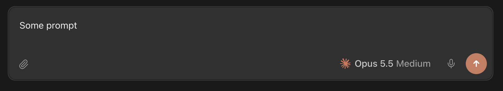

<p align="center"></p>

# Claude Desktop T3

A [T3 Code](https://github.com/pingdotgg/t3code) theme that matches the dark mode of the Claude desktop app.

## Install

### Option 1: Search in T3 Code

1. Open **Settings → Appearance → Add a theme**.
2. Search for **Claude Desktop T3**.
3. Click **Install**.

This installs the dark colors only. T3 Code doesn't load custom CSS from Open VSX themes.

### Option 2: Import the full theme (recommended)

This version includes the custom CSS: the Claude-style composer, send buttons colored by model (Claude orange, Gemini blue), and restyled menus, dialogs, settings, switches and tooltips.

### Send button colored by model

The composer's send button changes color to match the selected model's provider:

| Model | Send button |
| --- | --- |
| Claude | Claude orange |
| Gemini | Gemini blue |
| Anything else | Neutral white |

**Claude**



**Gemini**


**Other models**


This is part of the custom CSS, so it only works with the imported `claude-desktop.json`, not the Open VSX version.

The file also has a light variant. It hasn't been checked against the Claude app's light mode, so treat it as a bonus rather than a match.

1. Download [`claude-desktop.json`](./claude-desktop.json).
2. In T3 Code, open **Settings → Appearance → Add a theme → Import a file**.
3. Choose the downloaded file.

## VS Code

The Open VSX package is also a regular VS Code color theme. Install **Claude Desktop T3** from Open VSX (VSCodium, Cursor and others) and pick *Claude Desktop T3*.

## Files

| Path | What it is |
| --- | --- |
| `claude-desktop.json` | The full T3 Code theme: dark colors, custom CSS and an untested light variant |
| `themes/claude-desktop-dark.json` | VS Code color theme used by the Open VSX package |
| `package.json` | Extension manifest for Open VSX |

## Building

```sh
npx @vscode/vsce package
npx ovsx publish claude-desktop-t3-<version>.vsix -p <token>
```

## Credits

Made by [sitefinitysteve](https://www.sitefinitysteve.com). Not affiliated with Anthropic.

## License

[MIT](./LICENSE)
