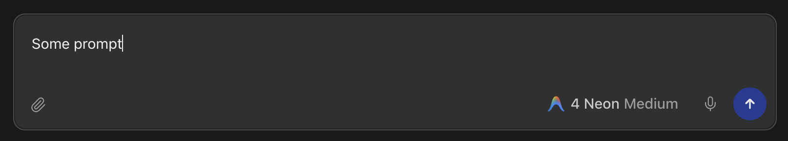
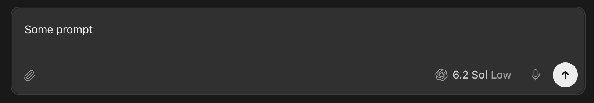

<p align="center"></p>

# Claude Desktop T3

A [T3 Code](https://github.com/pingdotgg/t3code) theme that matches the dark mode of the Claude desktop app.

## Install

1. Download **[claude-desktop.json](https://raw.githubusercontent.com/sitefinitysteve/Claude-Desktop-T3-Theme/main/claude-desktop.json)** (right-click → *Save Link As…*).
2. In T3 Code, open **Settings → Appearance → Add a theme**.
3. Under **Or import a file**, choose `claude-desktop.json`.

That's the whole theme: the colors **and** the custom CSS that gives it the Claude desktop look.

## What's in it

- Claude desktop dark palette for the sidebar, chat, code blocks and terminal
- Claude-style composer and message bubbles
- Send button colored by model (below)
- Restyled menus, popovers, dialogs, tooltips, toasts and settings (switches, selects, inputs, sliders)

### Send button colored by model

The composer's send button changes color to match the selected model's provider:

| Model | Send button |
| --- | --- |
| Claude | Claude orange |
| Gemini | Gemini blue |
| Anything else | Neutral white |

**Claude**


**Gemini**



**Other models**



## Colors-only version (T3 Code search / Open VSX)

The theme is also listed in T3 Code's theme search: **Settings → Appearance → Add a theme**, search **Claude Desktop T3**.

> [!WARNING]
> The search version is **colors only**. It doesn't have the custom CSS, so no model-colored send button, composer styling or restyled menus and dialogs. Use the file above for the full theme.
>
> Why: T3 Code's search installs from Open VSX, which hosts VS Code extensions. A VS Code color theme can only hold colors, and T3 Code's importer reads just a fixed list of them. Anything else, including CSS, is ignored.

The same package also works as a regular VS Code color theme in VSCodium, Cursor and other editors that use Open VSX.

## Light mode

`claude-desktop.json` also has a light variant. It hasn't been checked against the Claude app's light mode, so treat it as a bonus rather than a match. The Open VSX version is dark only.

## Files

| Path | What it is |
| --- | --- |
| `claude-desktop.json` | **The theme.** Colors, custom CSS and an untested light variant |
| `themes/claude-desktop-dark.json` | Colors-only VS Code theme used for the Open VSX package |
| `package.json` | Extension manifest for Open VSX |
| `images/` | Icon and screenshots |

## Building the Open VSX package

```sh
npx @vscode/vsce package
npx ovsx publish claude-desktop-t3-<version>.vsix -p <token>
```

## Credits

Made by [sitefinitysteve](https://www.sitefinitysteve.com). Not affiliated with Anthropic.

## License

[MIT](./LICENSE)
